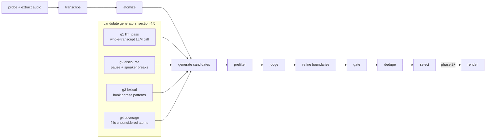

<div align="center">
  <h1>
    Clipper <sup><sub>v0.1.0</sub></sup>
  </h1>
  <p>
    <em>Finds the clips a good editor would pick from a long-form video, with exact timestamps, a score breakdown, and a reason.</em>
  </p>
  <br />

  
  
  
  
  
</div>

> **Status:** phase 1 (extraction engine, CLI only) is implemented and ran end to end on `tests/fixtures/sample_3min.mp4` against the live LLM proxy. Still open from the phase 1 "done when": a real golden set (5 hand-annotated videos) to measure hit@5 / recall_pool / trap_rate, and a 60-minute cost check. The system is described below as specified in [`clipper-spec.md`](./clipper-spec.md).

## The problem

Every existing short-form clipper — Opus Clip, Vizard, Choppity — collapses clip quality into a single opaque "virality score" and burns credits on upload minutes whether or not the source has any good moments in it. None of them tell you *why* a clip was picked, and none of them let you say what "good" means for your show.

Clipper treats clip discovery as the product, not a side effect of rendering. It takes a long mp4, transcribes it, generates a large pool of candidate windows from several independent deterministic and LLM-based generators, has an LLM judge score each candidate on seven named dimensions (hook, value, emotion, curiosity, novelty, completeness, payoff), then deterministically refines boundaries, filters, deduplicates, and greedily selects a diverse final set. Every clip ships with its full score breakdown and a one-line reason grounded in the transcript — never a bare number.

The interesting bet: recall early, precision late. Cheap deterministic generators (discourse breaks, lexical hooks, a coverage safety net) and one long-context LLM pass over the whole transcript over-generate 40-250 raw candidates per episode; only the pre-filtered top set pays for an LLM judge call. The design target is under $0.50 of LLM cost for a 60-minute episode (not yet verified; the 60-minute cost check is still open), while still measuring recall against human-annotated "must find" moments, not just precision on whatever the model happened to select. Rendering, captions, and reframing are explicitly downstream and out of scope until discovery quality is proven — phase 1 ships as a CLI-only Python package with no web, queue, or database.

## Features

**LLM-blind timestamps** — the LLM only ever sees and emits atom (sentence) ids, never raw timestamps; code maps ids to word-level timings, so the model can't hallucinate a boundary mid-word.

**Multi-generator candidate pool** — four generation strategies (`llm_pass`, `discourse`, `lexical`, `coverage`) each propose windows independently, with a keyword `query` generator specified for a later phase; candidates are merged by atom range with generator provenance kept for debugging.

**Explicit, versioned scoring** — a documented formula turns seven 1-10 judge dimensions plus standalone-level and penalties into a single 0-100 score in `clipper/config.py`, per-content-type overridable, never a black box.

**Cached, schema-validated LLM calls** — every call is content-hashed, cached to disk, retried up to 3 times on schema failure, and degrades to a logged fallback rather than crashing a run.

**Full run introspection** — `clipper inspect` shows every candidate's fate (kept, rejected, deduped) with a reason, `clipper cost` sums LLM spend, and every stage is independently re-runnable from its own JSON files in `runs/<run_id>/`.

**Evaluation harness as the design authority** — `clipper eval` runs a golden set of hand-annotated videos (tier-1/tier-2 must-find moments plus explicit "traps" that must not be selected) and reports `hit@n`, `recall_pool`, `trap_rate`, and `boundary_mae_ms`; no scoring change ships without moving these numbers.

## How it works

### Pipeline



Every stage is a pure function `run_<stage>(run_dir, cfg) -> None` that reads its inputs and writes its outputs as plain JSON in `runs/<run_id>/` — any stage can be re-run alone (`clipper stage <name> <run_dir>`), and unchanged LLM inputs cost nothing to re-run thanks to the content-hash cache.

### Key decisions

- **Openai-compatible chat completions for every LLM provider** over provider-specific SDKs, because it makes Gemini, Groq, OpenAI, and a self-hosted proxy interchangeable behind one `clipper/llm/client.py` and one model-alias registry — swapping the judge model is a config change, not a code change.
- **Groq Whisper (`whisper-large-v3-turbo`) as the default transcriber** over local `faster-whisper` because it costs ~$0.04/hour with no GPU requirement; `faster-whisper` stays as a fallback behind the same `Transcriber` protocol for non-retryable Groq errors.
- **Deterministic atomization and boundary refinement, LLM only for selection and judging** — sentence splitting, pause detection, and boundary snapping are pure code (testable, cheap, reproducible); the LLM is reserved for the two decisions that actually require judgment: which windows might be clips, and whether a given window stands alone.
- **A coverage generator as a safety net** over trusting the LLM pass to find everything, because a single long-context call can silently skip sections of a transcript — `coverage` guarantees every atom is inside at least one candidate before judging.
- **Eval harness gates every heuristic change** — scoring weights, prefilter thresholds, and generator caps are documented as "heuristics to be tuned against the eval harness, not truths" (spec section 8); a phase 5 learned prefilter is only allowed to replace the heuristic one after it beats it on the golden set.

## Tech stack

| Technology | Role | Why |
|---|---|---|
| Python 3.12 | Engine language | — |
| uv | Dependency management | — |
| Pydantic v2 | Every on-disk data type (`Atom`, `Candidate`, `JudgeResult`, ...) | Schema validation on every stage boundary, not just at the edges |
| typer | CLI (`clipper run` / `stage` / `render` / `inspect` / `eval` / `cost`) | — |
| ffmpeg / ffprobe | Probe, audio extraction, cutting, loudness normalization | No Python wrapper — shells out directly, never trusts filename/extension |
| Groq (`whisper-large-v3-turbo`) | Default transcription | ~$0.04/hr, no GPU; chunked 10-min windows with 2s overlap for Groq's request size cap |
| faster-whisper | Fallback transcription | Local, GPU-optional, used behind the same `Transcriber` protocol |
| Gemini Flash (via OpenAI-compatible proxy) | Default generator + judge model | Long-context flash model keeps a 60-min transcript (~12k tokens) cheap for the single whole-episode `llm_pass` call |
| sentence-transformers (`bge-small-en-v1.5`) | Local embeddings for semantic dedupe / keyword query | Avoids an API round-trip for the default `embedder: local` |
| pytest | Unit + integration tests | Never mocks ffmpeg/ffprobe — runs against a committed real fixture (`sample_3min.mp4`) |

## Repository layout

```
clipper/
  pyproject.toml            uv-managed, python 3.12
  CLAUDE.md                 working rules, kept in sync with clipper-spec.md
  clipper/
    cli.py  config.py  types.py  pipeline.py  report.py
    llm/            client.py cache.py registry.py
    prompts/        generator_v1.md judge_v1.md
    stages/         probe.py transcribe.py atomize.py generate.py
                     prefilter.py judge.py refine.py gate.py dedupe.py select.py   (render.py: phase 2)
    generators/     llm_pass.py discourse.py lexical.py coverage.py
    transcribers/   groq.py faster_whisper.py
    embed/          local.py api.py
    media/          ffmpeg.py probe.py
    eval/           metrics.py runner.py
  tests/
    fixtures/       sample_3min.mp4  golden/   (annotated eval videos)
    unit/  integration/
  runs/                      gitignored, one dir per pipeline run
```

Full stage-by-stage contract, data schemas, scoring formula, and phase boundaries are in [`clipper-spec.md`](./clipper-spec.md).

## Getting started

```bash
uv sync
cp .env.example .env   # FREELLM_BASE_URL + FREELLM_API_KEY: the openai-compatible proxy every LLM and transcription call goes through

uv run clipper run tests/fixtures/sample_3min.mp4 --out runs/demo/   # prints selected.md
uv run clipper inspect runs/demo/     # per-stage counts, every candidate and its fate, cost
uv run clipper cost runs/demo/
uv run clipper stage judge runs/demo/ # re-run one stage from its files (LLM calls are cached)
uv run clipper eval tests/fixtures/golden/ --config configs/podcast.yaml
```

`--stop-after <stage>` halts a run early. With `transcriber: faster_whisper` in the config, transcription runs locally and needs no key. The first dedupe run downloads `bge-small-en-v1.5` (about 130 MB) for the local embedder.

`tests/fixtures/golden/sample_3min/` holds a synthetic annotation used only as an eval smoke test; real golden entries need a human annotator (spec section 11.1).

Tests: `uv run pytest -m "not slow"` is the fast suite. The unmarked run adds real local whisper inference and a full pipeline run on the fixture (a few minutes on CPU).

Known limits: the proxy sometimes returns segments without word timestamps, so clip edges can then only be as precise as segment edges (see `DECISIONS.md`); the proxy's free upstream models churn, and a stale alias shows up as `judge_fallback_used` events in `log.jsonl` and flat 38.0 scores.

## Configuration

Resolved per run from `config.yaml`, all keys optional:

| Key | Default | Description |
|---|---|---|
| `clip_count` | `5` | Number of clips to select |
| `min_duration_ms` / `max_duration_ms` | `25000` / `90000` | Clip length bounds |
| `content_type` | `podcast` | `podcast \| interview \| lecture \| stream \| auto` — adjusts scoring weights and hook list |
| `language` | `auto` | ISO 639-1 or provider auto-detect |
| `keywords` | `[]` | Steers the `query` generator (specified, not yet implemented) |
| `editorial_instructions` | `""` | Free text appended to the judge prompt |
| `platform` | `shorts` | `shorts \| tiktok \| reels \| generic` |
| `allow_multi_segment` | `false` | Enables cut-and-concat multi-segment clips (phase 3) |
| `transcriber` | `groq` | `groq \| faster_whisper` |
| `llm_generator` / `llm_judge` | `gemini-flash` | Model alias, resolved via `clipper/llm/registry.py` |
| `embedder` | `local` | `local \| api` |
| `render` / `captions` / `reframe` | `false` / `false` / `none` | Phase 2+, 3+, 4+ respectively |

## Roadmap

| Status | Phase |
|---|---|
| ✅ (eval set pending) | **Phase 1** — extraction engine, CLI only: probe → transcribe → atomize → generate → prefilter → judge → refine (contiguous) → gate → dedupe → select, plus `inspect`/`cost`/`eval` |
| 🔲 | **Phase 2** — accurate cut + loudnorm render, real audio features (rms/silence), audio-event generator |
| 🔲 | **Phase 3** — burned-in captions, multi-segment clips, FastAPI service + Postgres job queue, object storage |
| 🔲 | **Phase 4** — Next.js review UI (approve/reject/adjust by dragging on transcript), center/face reframing, optional diarization |
| 🔲 | **Phase 5** — native-video (g7) generator, per-project knowledge injection, learned prefilter trained on review data, evaluated against the heuristic before it's allowed to replace it |

Each phase ends with a git tag and does not start the next until its "done when" criteria hold ([`clipper-spec.md`](./clipper-spec.md) section 12).

## License

**Source-available, not open source.** Clipper is published under the
[PolyForm Strict License 1.0.0](LICENSE): you may read, run, and learn from the code
for personal, research, or evaluation use.

You may **not** use it commercially, redistribute it, rebrand it, or publish modified
versions without written permission. Copyright (c) 2026 Yassine Krichen. All rights
not granted by the license are reserved.

For commercial licensing or collaboration: krichenyassine22@gmail.com

---

Built by [Yassine Krichen](https://github.com/yassine-krichen)
